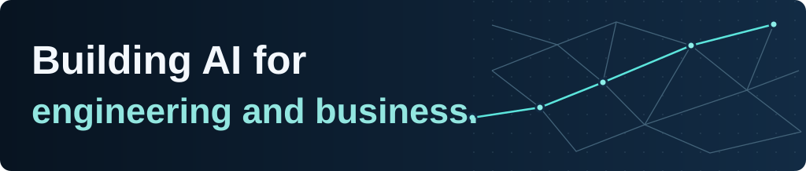

# Deepak Prasanna N

Bavaria, Germany · Enterprise AI · Industrial digitalization · Technology strategy

I came to AI through mechatronics and industrial digitalization. I enjoy working with the people who know a process well enough to explain where it breaks down, then building something they can try. My interests span both sides of that work: how to build a reliable AI application and how to decide whether it is worth adopting.

## From a business problem to a working system

**Digitalization.** In industry, I’ve worked with business stakeholders to identify AI use cases, assess feasibility and translate requirements into working tools. My work has also included testing, technical documentation and knowledge transfer. Those later steps shape the questions I ask early. Who will check the output? Which exceptions still need a person? How will the team know whether the new workflow helps?

**Enterprise AI on Azure.** For my mechatronics thesis at THWS, I built a memory-enhanced chatbot around a practical problem: a user returns to an old topic after several unrelated exchanges. Sending the whole transcript uses input tokens on conversations that have little to do with the question. My Python application ranks earlier turns by relevance and selects a short window of surrounding dialogue. Azure Cosmos DB stores the conversation history, Azure AI Search retrieves document passages, and Azure OpenAI supplies embeddings and generates the answer. A Streamlit inspector lets me see exactly which passages and conversations reached the model and estimate their token use.

**Product and technology strategy.** I’ve also evaluated enterprise AI platforms, including Snowflake Cortex Analyst. Building a prototype and evaluating an existing platform are different decisions. In both cases I want to understand what data the tool needs, how someone can verify an answer, and what it would take to fit the tool into an existing process. I’m especially interested in roles where I can help a team make that decision and stay involved through implementation.

## Selected work

- **Memory-Enhanced RAG Chatbot** · Bachelor’s thesis, grade **1.3**. I evaluated selective recall through conversational case studies. One test revisited the first topic after nine others and used the prompt preview to inspect which earlier turns the chatbot recovered.
- **Engineering Change Reviewer** · A Python tool that puts two specification revisions side by side. It flags a tightened shaft tolerance and recognizes that 1 MPa and 10 bar are equivalent. In six held-out synthetic revision pairs, it found all 13 expected changes and raised two false alarms when a requirement changed IDs.
- **Maintenance Tool Assistant and Citation Eval** · Two small demos for checking AI outputs. One traces an equipment answer through asset and inventory lookups. The other identifies missing and unexpected sources in a generated answer.

## What I want to explore next

I’m interested in **agentic AI and intelligent automation**, particularly how an assistant should handle missing data or pause for approval. In **analytics and business intelligence**, I’d like to build a natural-language interface that lets a manufacturing analyst trace an answer back to its SQL query and source rows.

My longer-term interest is **forward-deployed engineering and AI product strategy**: working directly with users, choosing a useful first deployment, and measuring what changes once people start using it.

[Find me on GitHub](https://github.com/deepakprasanna-codes)
